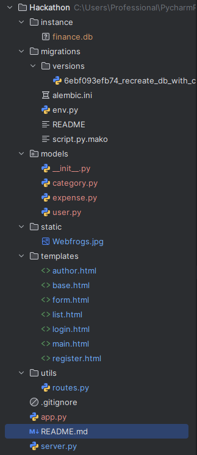
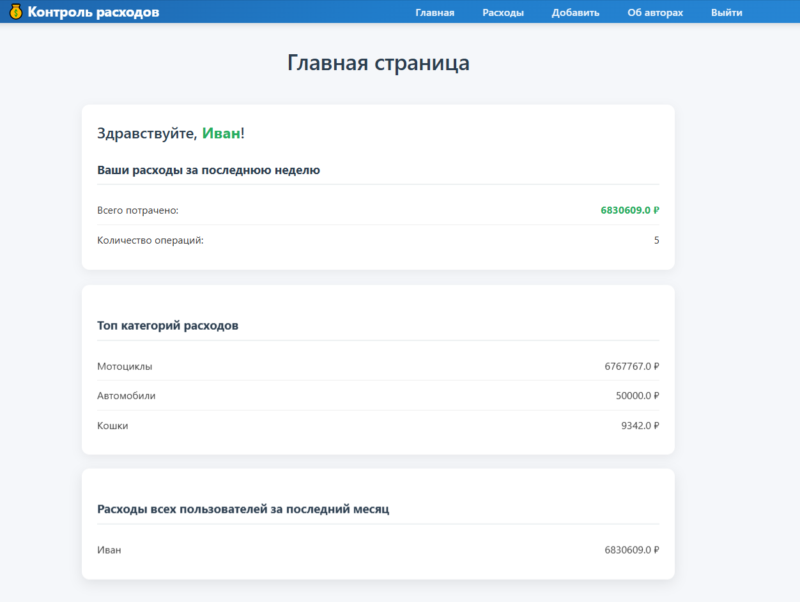
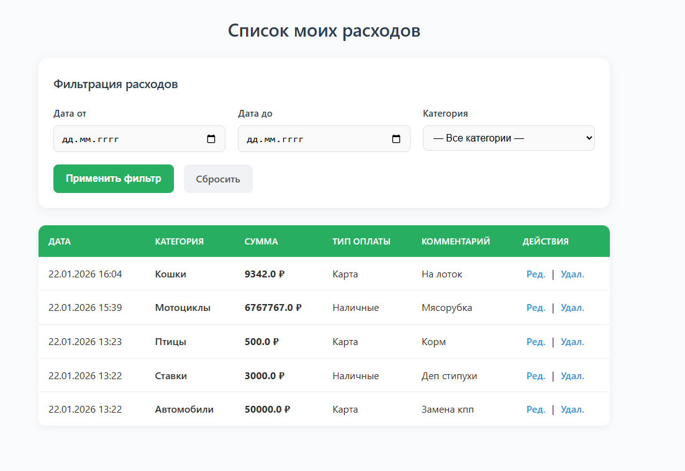
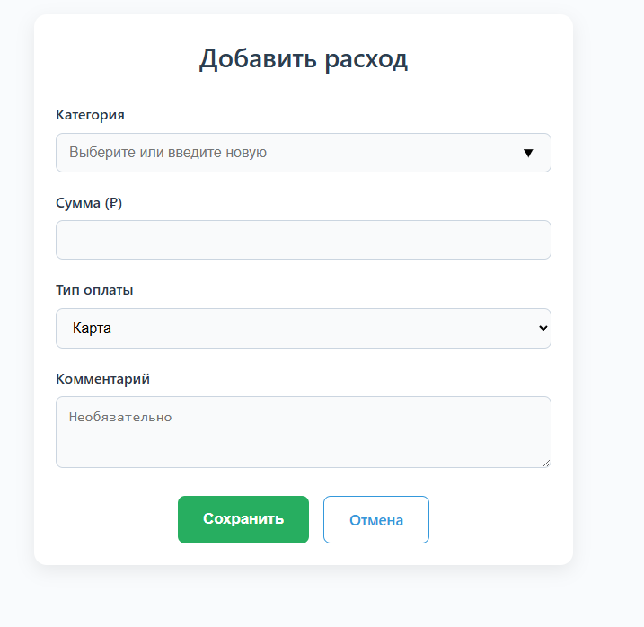
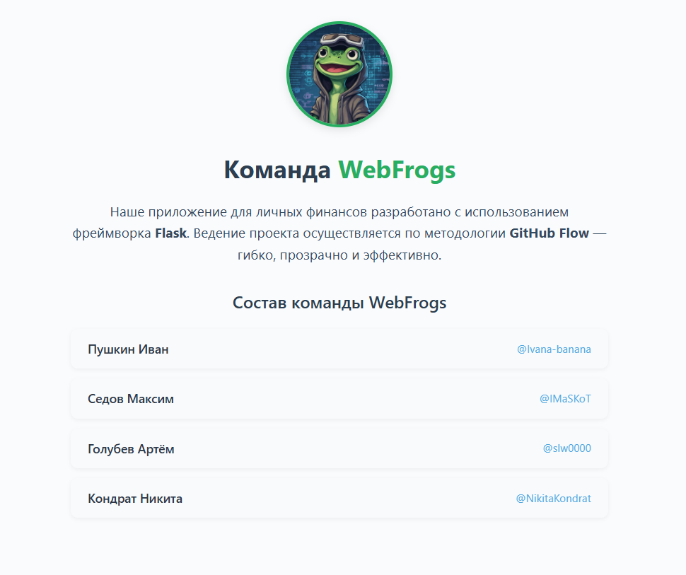
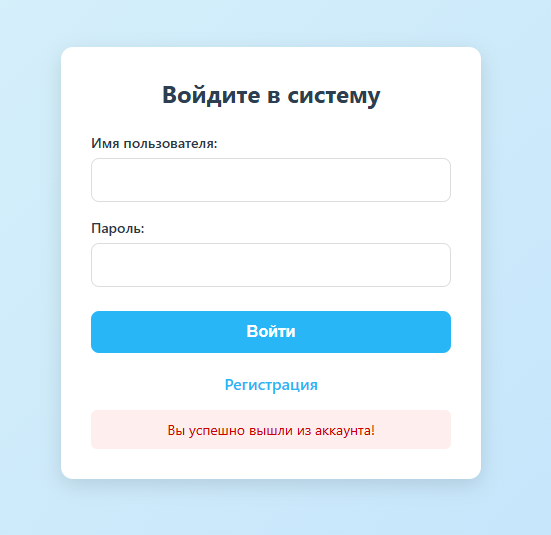
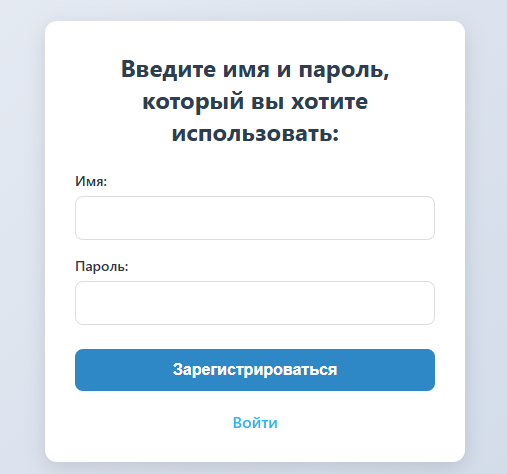
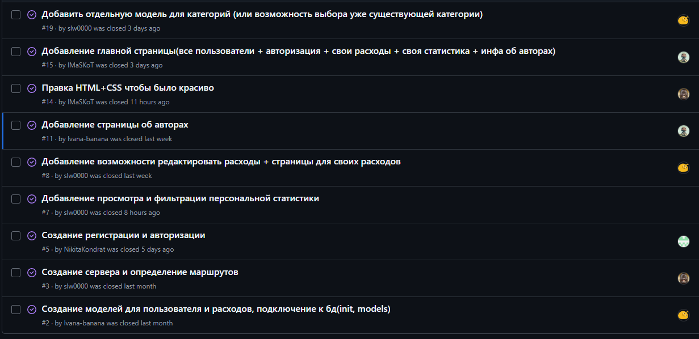
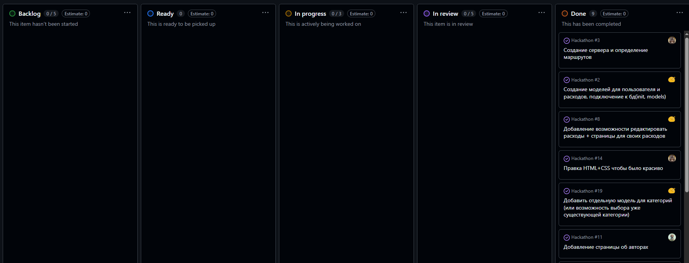
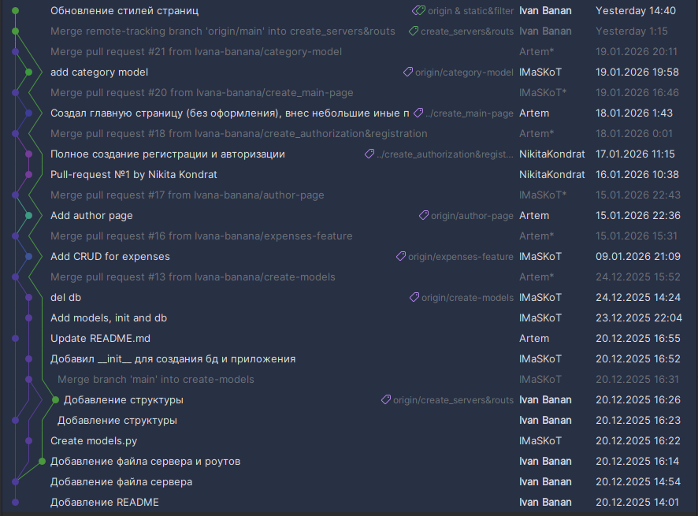

#  Сайт для контроля персональных расходов

> **Команда:** WebFrogs  
> **Технологический стек:** Flask (Python)  
> **Методология разработки:** GitHub Flow  

---

##  Состав команды

- **Пушкин Иван** - фронтенд, реализация фильтрации и статистики для каждого пользователя, составление отчёта
- **Седов Максим** - создание базы данных и миграций, создание моделей
- **Голубев Артём** - реализация функционала страниц, создание моделей
- **Кондрат Никита** - регистрация и авторизация, внесение данных в базу

---

## Обзор проекта

#### 1. Структура проекта с назначением файлов

##### Controllers
- ```instance``` - папка для хранения базы данных
- ```migratioins``` - папка для хранения миграций
- ```migrations/versions/regreate_db``` - миграция Alembic
- ```migrations/env``` - код для записи изменений в базу данных
- ```utils/routes``` - реализация маршрутов
- ```app``` - создание сервера, базы данных и т.д.
- ```server``` - запуск сервера

##### Models
- ```models``` - папка для хранения моделей
- ```models/category``` - объект категории расходов
- ```models/expense``` - объект расхода какой-то категории какого-то пользователя
- ```models/user``` - объект пользователя

##### View
- ```static``` - папка для хранения изображений
- ```templates``` - папка для хранения шаблонов Jinja2
- ```templates/author``` - шаблон для страницы авторов
- ```templates/base``` - шаблон для отображения маршрутов сайта
- ```templates/form``` - шаблон для страницы добавления расходов
- ```templates/list``` - шаблон для страницы отображения списка расходов и их редактирования
- ```templates/login``` - шаблон для страницы логирования
- ```templates/main``` - шаблон для главной страницы
- ```templates/register``` - шаблон для страницы регистрации


#### 2. Описание моделей

- ```Category```: ```id``` - уникальный номер категории
                  ```name``` - наименование категории
                  ```user_id``` - номер пользователя, к которому привязана данная категория
- ```Expense```: ```id``` - уникальный номер расхода
                 ```category_id``` - номер категории
                 ```user_id``` - номер пользователя, которому принадлежит трата
                 ```amount``` - сумма траты
                 ```paytype``` - тип оплаты
                 ```comment``` - комментарий
                 ```date``` - дата совершения траты
- ```User```: ```id``` - уникальный номер пользователя
              ```username``` - имя пользователя
              ```password``` - пароль
              ```expenses``` - расходы пользователя

#### 3. Обзор функционала
**Главная страница**

Отображение статистики: расходы за последнюю неделю и топ-3 категории расходов

Отображение расходов всех пользователей сайта



**Страница индивидуальных расходов пользователя**

Вывод таблицы с развёрнутой информацией о каждом расходе

Возможность удаления или редактирования того или иного расхода

Фильтр расходов по дате и категории




**Страница добавления расхода**

Выбор существующей категории или создание новой

Сумма расхода

Тип оплаты

Комментарий к расходу




**Страница об авторах проекта**




**Страница авторизации**




**Страница регистрации**




### 4.Работа в группе

Использовалась методология **GitHub Flow**

Задачи распределялись с помощью пула тасков на GitHub





Под каждый таск создавалась своя ветка. После завершения работы над задачей, создавался pull-request,
который для дальнейшего слияния с main проходил проверку других участников команды



### 5.Сложности

Самой главной сложностью в процессе выполнения работы, стало создание миграций для базы данных,
ибо пришлось ознакомиться с совершенно новым материалом, прочить про alembic и оффлайн и онлайн изменения.
Нелегко также далась реализация регистрации и авторизации, пришлось долго искать ошибки при записи нового
пользователя в бау 


### 6.Ссылка на полный скринкаст